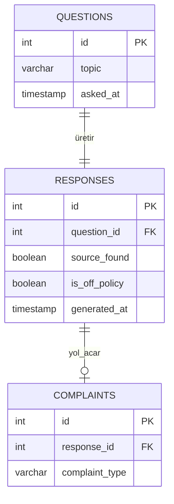

## Veri Modeli

### 2.1 Güncel ERD

* **İlişki Açıklamaları:**
  * Bir `question`, tam bir `response`'a sahiptir; bir `response`, tam bir `question`'a aittir.
  * Bir `response`, sıfır veya bir `complaint`'e sahiptir; bir `complaint`, tam bir `response`'a aittir.

### 2.2 Normalizasyon Notu

| Tablo Adı | Neden Ayrıldı / Ayrılmadı? (Fonksiyonel Bağımlılık) | Form | Somut Örnek |
| :--- | :--- | :--- | :--- |
| `questions` | Soruya ait konu (`topic`) ve zaman (`asked_at`) bilgileri yalnızca soru kimliğine (`id`) bağlıdır; yanıt detaylarıyla tekrar etmemesi için ayrı tutulmuştur. | **1NF** | Tüm sütunlar atomik değerler içerir; örneğin `topic` alanında çoklu etiketler yerine tekil değerler (`payment`, `return`) yer alır. |
| `responses` | `source_found`, `is_off_policy` ve `generated_at` alanları doğrudan yanıt kimliğine (`id`) bağlıdır; soru detayları `question_id` (FK) ile ilişkilendirilmiştir. | **2NF** | Kısmi bağımlılık yoktur; tablonun birincil anahtarı tekil bir sütundur (`id`). |
| `complaints` | Şikâyetler her yanıtta oluşmadığı (600 yanıtta 135 şikâyet) ve `complaint_type` bilgisi yalnızca şikâyetin kendi `id`'sine bağlı olduğu için ayrı bir tabloda modellenmiştir. | **3NF** | Geçişli bağımlılıklar arındırılmıştır; örneğin `questions.topic` bilgisi `complaints` tablosuna taşınmayarak veri tekrarı önlenmiştir. |

### 2.3 İki JOIN Sorusu

1. **Soru 1 (`INNER JOIN`):**
   * **Türkçe Soru:** Politika dışı (`is_off_policy = true`) yanıt üretilen soruların konularını (`topic`) ve bu yanıtlara gelen müşteri şikâyet türlerini (`complaint_type`) listele.
   * **Birleşme Koşulu:** `questions.id = responses.question_id` ve `responses.id = complaints.response_id`
   * **JOIN Türü ve Nedeni:** `INNER JOIN` kullanılır; çünkü hem politika dışı yanıt verilen hem de müşteri şikâyetine dönüşen (üç tabloda da ortak olan) kayıtlar analiz edilmektedir.

2. **Soru 2 (Eşleşmeyen Kayıtlar - `LEFT JOIN`):**
   * **Türkçe Soru:** Politika dışı (`is_off_policy = true`) olduğu halde müşteriden hiçbir şikâyet almamış olan yanıtların ID'lerini ve üretilme zamanlarını bul.
   * **Birleşme Koşulu:** `responses.id = complaints.response_id` (Filtre: `WHERE complaints.id IS NULL AND responses.is_off_policy = true`)
   * **JOIN Türü ve Nedeni:** `LEFT JOIN` kullanılır; çünkü sol tablodaki (`responses`) tüm politika dışı yanıtları koruyup, sağ tabloda (`complaints`) eşleşen kaydı bulunmayanları (`IS NULL`) tespit etmek amaçlanır.